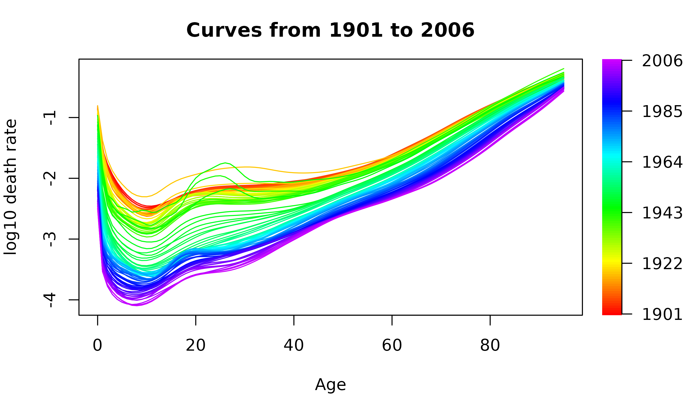
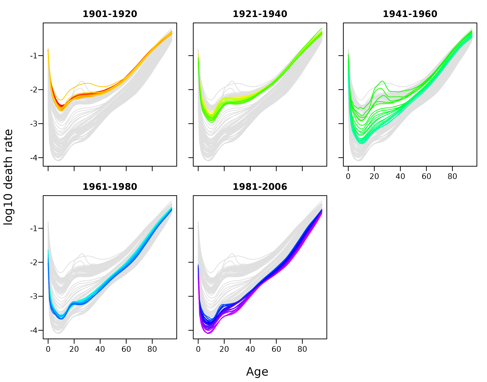
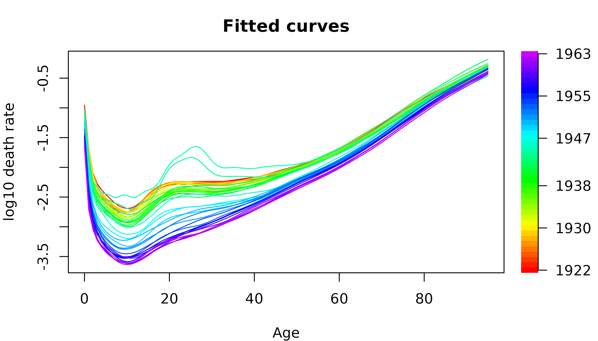
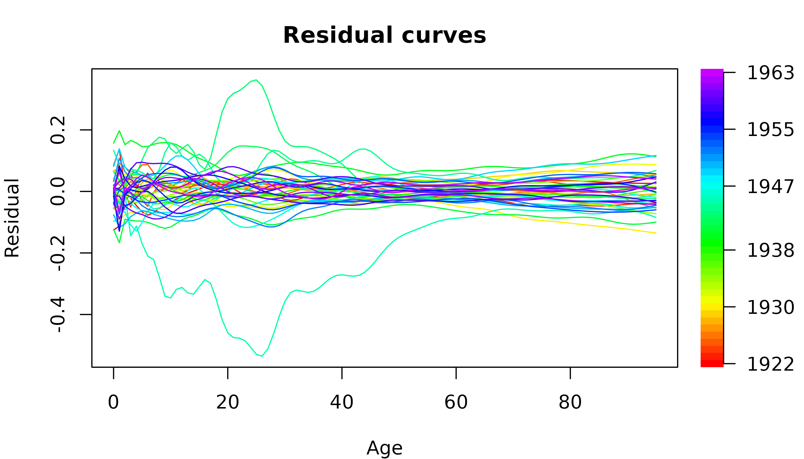
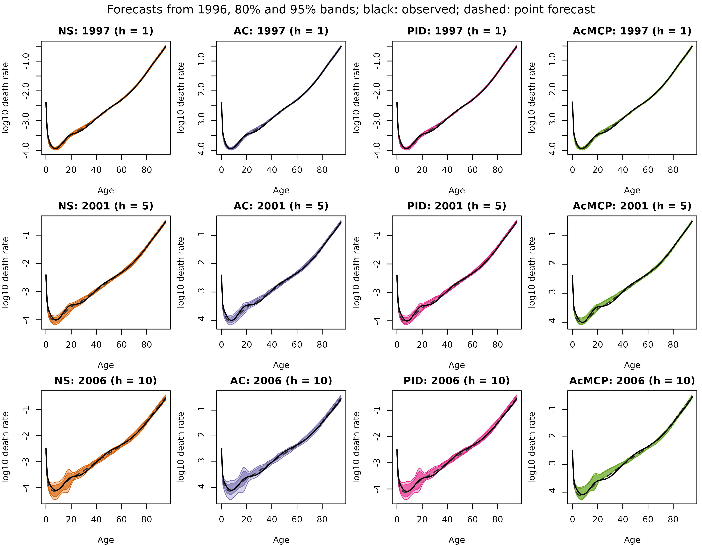
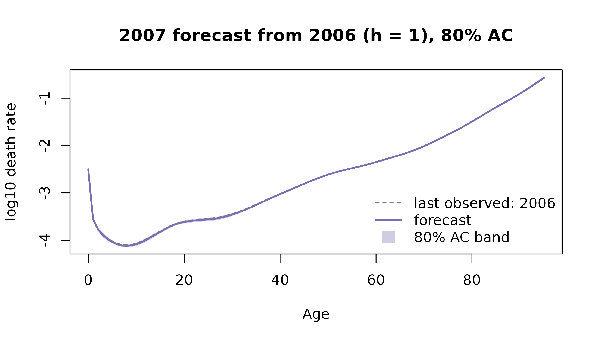
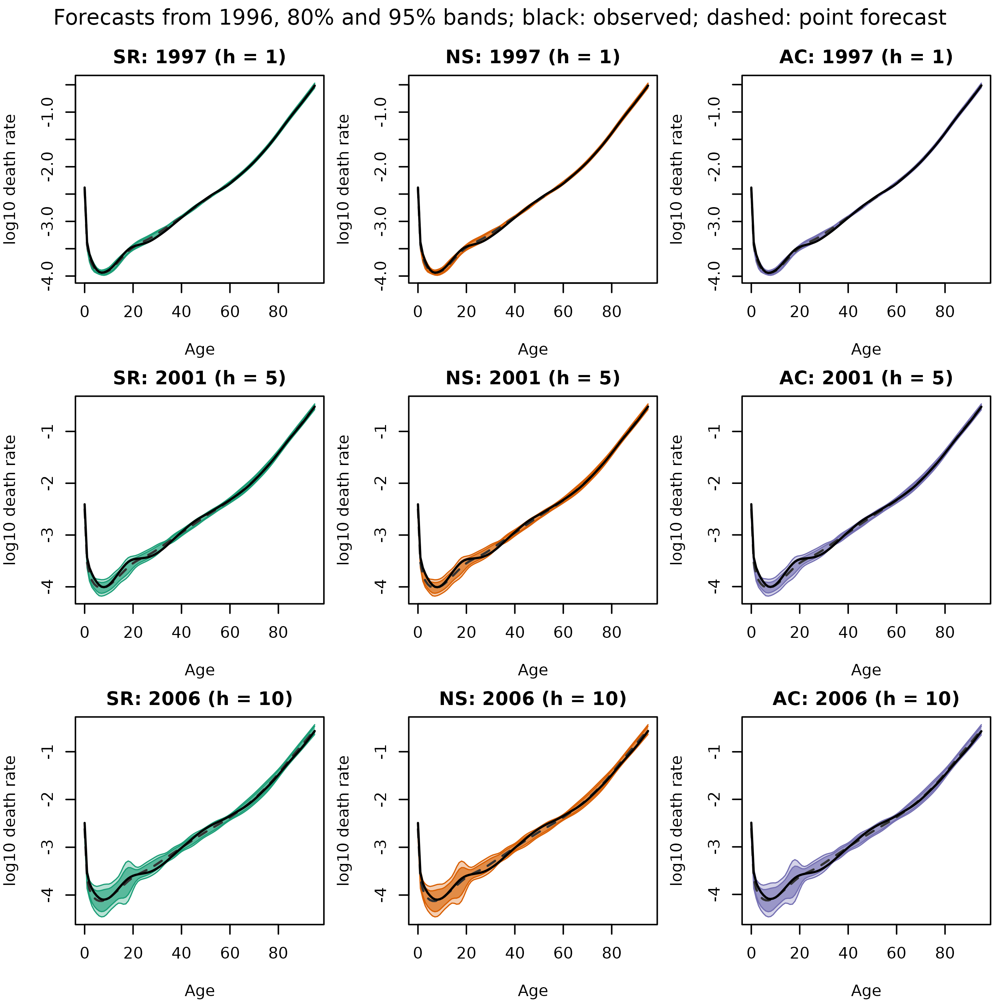
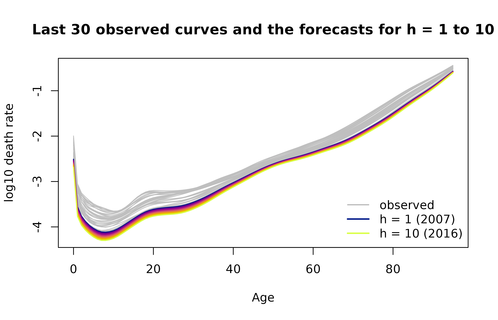
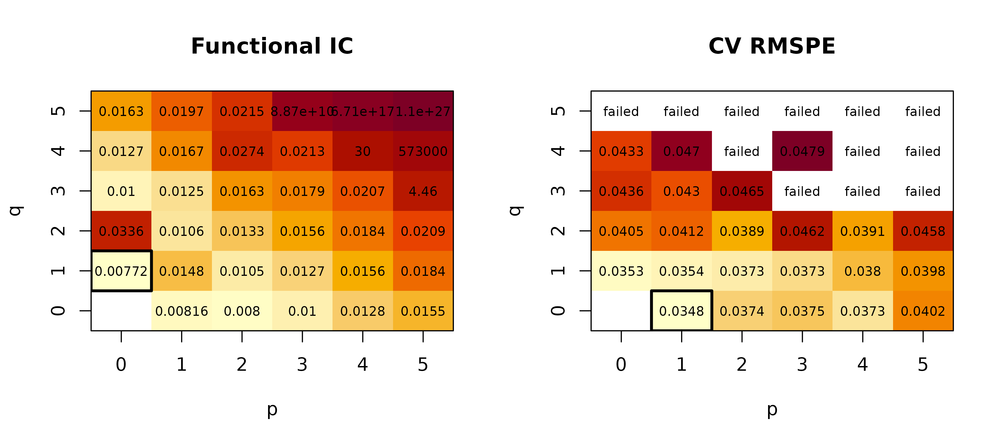
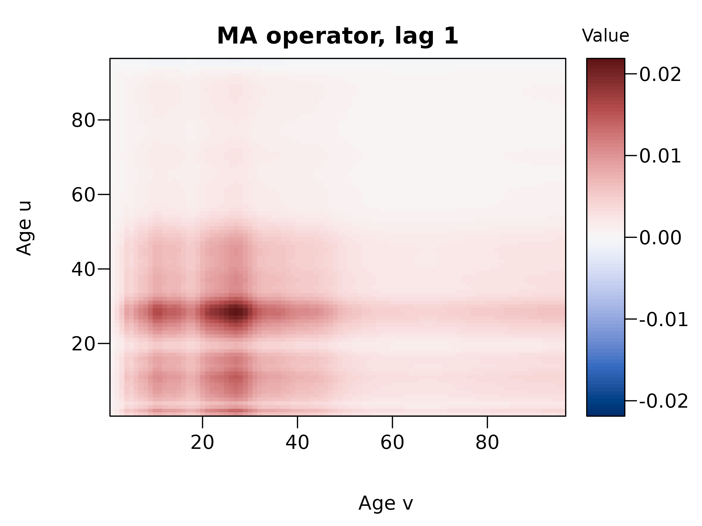

# farfima: Order Selection and Forecasting in Long-Memory Functional Time Series

## 1. Introduction

A functional time series is a sequence of curves observed over time,
such as age-specific death rates in successive years. When the
dependence between the curves decays slowly, the series has long memory.
The functional autoregressive fractionally integrated moving-average
(FARFIMA) model describes such series. The curves $`X_t`$ are
fractionally differenced into short-memory curves $`Y_t`$,
``` math
\nabla^d X_t(u) = Y_t(u), \qquad \nabla = 1 - B,
```
where $`B`$ is the backshift operator and $`d`$ is the memory parameter.
The curves $`Y_t`$ follow a functional autoregressive moving-average
(FARMA) model of orders $`p`$ and $`q`$,
``` math
Y_t(u) - \sum_{i=1}^{p} (\Phi_i Y_{t-i})(u) = \eta_t(u) + \sum_{j=1}^{q} (\Theta_j \eta_{t-j})(u),
```
with autoregressive operators $`\Phi_i`$, moving-average operators
$`\Theta_j`$ and innovations $`\eta_t`$.

The farfima package fits this model in three steps. It estimates $`d`$,
selects $`p`$ and $`q`$, and estimates the operators. It then forecasts
the curves with conformal prediction bands. The main functions are:

| Function | Purpose |
|----|----|
| [`plot_curves()`](https://chang-liu-0122.github.io/farfima/reference/plot_curves.md) | Rainbow plots of the curves |
| [`split_curves()`](https://chang-liu-0122.github.io/farfima/reference/split_curves.md) | Training, validation and test samples |
| [`farfima()`](https://chang-liu-0122.github.io/farfima/reference/farfima.md) | Fit the model and calibrate the conformal prediction bands |
| [`fitted()`](https://rdrr.io/r/stats/fitted.values.html), [`residuals()`](https://rdrr.io/r/stats/residuals.html), [`plot()`](https://rdrr.io/r/graphics/plot.default.html) | The in-sample fit |
| [`predict()`](https://rdrr.io/r/stats/predict.html) | Forecasts, and their evaluation on a test sample |
| [`plot()`](https://rdrr.io/r/graphics/plot.default.html), [`as.data.frame()`](https://rdrr.io/r/base/as.data.frame.html) | Plots and tables of the forecasts |
| [`estimate_memory()`](https://chang-liu-0122.github.io/farfima/reference/estimate_memory.md), [`frac_diff()`](https://chang-liu-0122.github.io/farfima/reference/frac_diff.md), [`select_order()`](https://chang-liu-0122.github.io/farfima/reference/select_order.md), [`estimate_operators()`](https://chang-liu-0122.github.io/farfima/reference/estimate_operators.md) | The steps of [`farfima()`](https://chang-liu-0122.github.io/farfima/reference/farfima.md) on their own |
| [`sim_farfima()`](https://chang-liu-0122.github.io/farfima/reference/sim_farfima.md) | Simulated curves |

Each section below introduces one function and then applies it to French
female mortality rates.

## 2. Data

The data are French female death rates from the demography package, for
the years 1901 to 2006. Ages 0 to 94 are kept as single years, and ages
95 and above are combined into one group, which avoids zero rates at the
oldest ages. The rates are smoothed by weighted penalised regression
splines, constrained to increase with age above 65, and taken on the
log10 scale. In farfima, curves are stored as a matrix with grid points
in rows and time in columns, here ages by years. `fts` objects from the
rainbow and ftsa packages also work.

``` r

library(farfima)
library(demography)
```

``` r

fr = extract.ages(extract.years(fr.mort, 1901:2006), 0:95)
x = log10(smooth.demogdata(fr, method = "mspline", b = 65, weight = TRUE)$rate$female)
dim(x)
#> [1]  96 106
```

## 3. Rainbow plots: `plot_curves()`

[`plot_curves()`](https://chang-liu-0122.github.io/farfima/reference/plot_curves.md)
draws the curves coloured by time, from red for the earliest to violet
for the latest. With `type = "rainbow"`, all curves are in one panel
with a colour bar. With `type = "periods"`, each period has its own
panel and the other curves are in grey. `periods` is the number of
periods, or the first year of each period.

The death rates fall over time at almost all ages. The curves of the war
years stand out at young adult ages.

``` r

plot_curves(x, xlab = "Age", ylab = "log10 death rate")
```



``` r

plot_curves(x, type = "periods", periods = c(1901, 1921, 1941, 1961, 1981), xlab = "Age",
            ylab = "log10 death rate")
```



## 4. Training, validation and test samples: `split_curves()`

[`split_curves()`](https://chang-liu-0122.github.io/farfima/reference/split_curves.md)
splits the curves in time order. `train` and `valid` are the proportions
of curves in the training and validation samples, rounded down, and the
remaining curves form the test sample. The model is estimated on the
training sample, the conformal prediction bands are calibrated on the
validation sample, and the forecasts are evaluated on the test sample.

``` r

blocks = split_curves(x, train = 0.6, valid = 0.2)
sapply(blocks, ncol)
#> train valid  test 
#>    63    21    22
```

The training sample covers 1901 to 1963, the validation sample 1964 to
1984 and the test sample 1985 to 2006.

## 5. Fitting the model: `farfima()`

[`farfima()`](https://chang-liu-0122.github.io/farfima/reference/farfima.md)
fits the model to the training sample in three steps. First, it
estimates $`d`$ with
[`estimate_memory()`](https://chang-liu-0122.github.io/farfima/reference/estimate_memory.md).
Second, it centres and fractionally differences the training curves,
drops the first `trim` differenced curves, and selects $`p`$ and $`q`$
as in
[`select_order()`](https://chang-liu-0122.github.io/farfima/reference/select_order.md).
Third, it estimates the operators by the functional Hannan-Rissanen
method, as in
[`estimate_operators()`](https://chang-liu-0122.github.io/farfima/reference/estimate_operators.md).
With a validation sample, it also forecasts up to `h` steps ahead from
every validation origin, and uses the forecast errors to calibrate the
conformal prediction bands for each horizon and level.

The main arguments are:

| Argument | Sets | Options |
|----|----|----|
| `d` | memory parameter | `"lw"`, `"dfa"`, `"lpwn1"`, `"lpwn2"`, `"bc_lpwn1"`, `"bc_lpwn2"`, or a number |
| `order` | FARMA orders | `"ic_full"`, `"ic_auto"`, `"bj"`, `"cv"`, or `c(p, q)` |
| `p`, `q` | candidate orders | e.g. `0:5` |
| `method` | operator estimator | `"farma"`, or `"far"` for the FAR(1) benchmark |
| `h` | longest horizon | `valid` needs at least `h + 1` curves |
| `level` | levels of the conformal prediction bands | e.g. `c(0.8, 0.95)` |
| `band` | conformal prediction bands | `"SR"`, `"NS"`, `"AC"`, `"PID"`, `"AcMCP"` |
| `symmetric` | symmetric AC and PID bands | `TRUE` or `FALSE` |
| `eta_grid` | candidate learning rates | e.g. `c(0, 0.005, 0.01, 0.02, 0.05, 0.1)` |
| `scorecast` | scorecaster of the PID band | `"none"`, `"naive"`, `"theta"` |
| `window` | window at each origin | `"expanding"` or `"fixed"` |
| `trim` | differenced curves dropped | e.g. 20 |
| `memory_args`, `order_args` | other settings of [`estimate_memory()`](https://chang-liu-0122.github.io/farfima/reference/estimate_memory.md) and [`select_order()`](https://chang-liu-0122.github.io/farfima/reference/select_order.md) | e.g. `list(B = 50)` |

The fit below estimates $`d`$ by BC-LPWN2, selects the orders by the
functional information criterion over $`p, q \in \{0, \dots, 5\}`$, and
calibrates the SR, NS and AC bands at the 80% and 95% levels for
horizons up to 10 years.

``` r

fit = farfima(blocks$train, blocks$valid,
                d = "bc_lpwn2", order = "ic_full", p = 0:5, q = 0:5,
                h = 10, level = c(0.8, 0.95), band = c("SR", "NS", "AC"),
                trim = 20, seed = 1)
#> Estimating d by BC-LPWN2 with 100 bootstrap samples
#> Selecting (p, q) by functional IC over 35 candidates
#> Calibrating the SR, NS, AC bands on 21 validation origins (12 at h = 10)
fit
#> FARFIMA(p = 0, d = 1.12, q = 1)
#>   Data:      96 grid points x 63 training curves, 21 validation curves
#>   Memory:    BC-LPWN2 on the leading score process of the empirical covariance operator (Covar), bandwidth exponent 0.75
#>              uncorrected d = 1.01, bootstrap bias = -0.11
#>              note: the LPWN estimate is at the boundary of its search interval
#>              note: 62% of the bootstrap estimates are at the boundary
#>   Orders:    functional IC (exhaustive search), 35 candidates
#>   Operators: functional Hannan-Rissanen estimator with 1 principal component, first 20 fractionally differenced curves trimmed
#>   Bands:     SR, NS, AC at 80%, 95% for h = 1..10, calibrated on 21 validation curves (expanding window)
```

The estimate of $`d`$ is 1.12. It is above 0.5, so the curves are
non-stationary. The selected model for the differenced curves is
FARMA(0, 1). The fit is a list:

``` r

fit$d
#> [1] 1.119545
fit$order
#> p q 
#> 0 1
names(fit)
#>  [1] "d"                  "order"              "phi"               
#>  [4] "theta"              "fitted"             "fitted_differenced"
#>  [7] "residuals"          "memory"             "order_selection"   
#> [10] "operators"          "calibration"
head(fit$order_selection$table)
#>   p q         F_T converged     penalty          IC
#> 1 0 1 0.005086746      TRUE 0.002629674 0.007716420
#> 2 0 2 0.028335153      TRUE 0.005259347 0.033594500
#> 3 0 3 0.002120173      TRUE 0.007889021 0.010009194
#> 4 0 4 0.002152126      TRUE 0.010518694 0.012670821
#> 5 0 5 0.003122546      TRUE 0.013148368 0.016270914
#> 6 1 0 0.005527590      TRUE 0.002629674 0.008157263
head(fit$calibration)
#>   level h SR_zeta NS_quantile AC_eta n_origin
#> 1   0.8 1    1.26   0.1294168    0.1       21
#> 2   0.8 2    1.40   0.2006289    0.1       20
#> 3   0.8 3    1.48   0.2321279    0.1       19
#> 4   0.8 4    1.70   0.3484235    0.1       18
#> 5   0.8 5    1.76   0.3724905    0.1       17
#> 6   0.8 6    1.94   0.4687595    0.1       16
```

### Other settings

Only the AC band:

``` r

fit_ac = farfima(blocks$train, blocks$valid, band = "AC", trim = 20, seed = 1, verbose = FALSE)
fit_ac
#> FARFIMA(p = 0, d = 1.12, q = 1)
#>   Data:      96 grid points x 63 training curves, 21 validation curves
#>   Memory:    BC-LPWN2 on the leading score process of the empirical covariance operator (Covar), bandwidth exponent 0.75
#>              uncorrected d = 1.01, bootstrap bias = -0.11
#>              note: the LPWN estimate is at the boundary of its search interval
#>              note: 62% of the bootstrap estimates are at the boundary
#>   Orders:    functional IC (exhaustive search), 35 candidates
#>   Operators: functional Hannan-Rissanen estimator with 1 principal component, first 20 fractionally differenced curves trimmed
#>   Bands:     AC at 80%, 95% for h = 1..10, calibrated on 21 validation curves (expanding window)
```

Other estimators, known values and the FAR(1) benchmark:

``` r

fit_lw = farfima(blocks$train, blocks$valid, d = "lw", order = "bj", trim = 20, seed = 1, verbose = FALSE)
fit_lw$d
#> [1] 0.8948049
fit_lw$order
#> p q 
#> 1 0

fit_known = farfima(blocks$train, blocks$valid, d = 1, order = c(1, 0), trim = 20, verbose = FALSE)
fit_known$order
#> p q 
#> 1 0

bench = farfima(blocks$train, blocks$valid, d = 1, method = "far", trim = 20, verbose = FALSE)
bench
#> FARFIMA(p = 1, d = 1, q = 0)
#>   Data:      96 grid points x 63 training curves, 21 validation curves
#>   Memory:    supplied
#>   Orders:    fixed at (1, 0) for the FAR(1) benchmark
#>   Operators: score-based FAR(1) with 4 components (95% of the variation), first 20 fractionally differenced curves trimmed
#>   Bands:     SR, NS, AC at 80%, 95% for h = 1..10, calibrated on 21 validation curves (expanding window)
```

### Without a validation sample

Without `valid` there are no conformal prediction bands, and
`order = "cv"` cannot be used.

``` r

fit_point = farfima(blocks$train, d = "lw", trim = 20, verbose = FALSE)
fit_point
#> FARFIMA(p = 1, d = 0.8948, q = 0)
#>   Data:      96 grid points x 63 training curves
#>   Memory:    LW on the leading score process of the empirical covariance operator (Covar), bandwidth exponent 0.75
#>   Orders:    functional IC (exhaustive search), 35 candidates
#>   Operators: functional Hannan-Rissanen estimator with 1 principal component, first 20 fractionally differenced curves trimmed
#>   Bands:     none (no validation sample), point forecasts only
```

``` r

farfima(blocks$train, order = "cv", trim = 20, verbose = FALSE)
#> Error:
#> ! `valid` is required for cross-validation.
```

## 6. In-sample fit: `fitted()`, `residuals()` and `plot()`

Each fitted curve is the one-step-ahead forecast of a training curve
from the curves before it, and each residual curve is the training curve
minus its fitted curve. They cover the training curves left after
trimming, and the first `max(p, q)` of them have no fit.
[`fitted()`](https://rdrr.io/r/stats/fitted.values.html) gives the
fitted curves on the scale of the data, or on the fractionally
differenced scale with `scale = "differenced"`.
[`plot()`](https://rdrr.io/r/graphics/plot.default.html) draws the
fitted curves, or the residual curves with `type = "residuals"`.

Here $`\max(p, q) = 1`$, so the first fitted curve, for 1921, is
missing. `fitted(fit) + residuals(fit)` returns the training curves.

``` r

round(fitted(fit)[1:3, 1:4], 3)
#>   1921   1922   1923   1924
#> 0   NA -0.953 -1.106 -1.038
#> 1   NA -1.677 -1.822 -1.704
#> 2   NA -2.095 -2.124 -2.143
round(fitted(fit, scale = "differenced")[1:3, 1:4], 4)
#>   1921    1922    1923    1924
#> 0   NA -0.0118 -0.0083 -0.0162
#> 1   NA -0.0173 -0.0126 -0.0231
#> 2   NA -0.0170 -0.0138 -0.0210
round(residuals(fit)[1:3, 1:4], 4)
#>   1921    1922   1923    1924
#> 0   NA -0.1258 0.0849 -0.0430
#> 1   NA -0.1122 0.1381 -0.0586
#> 2   NA -0.0025 0.0110 -0.0042
```

The fitted curves follow the training curves closely. The largest
residuals are in the early 1940s, during the Second World War.

``` r

plot(fit, xlab = "Age", ylab = "log10 death rate")
```



``` r

plot(fit, type = "residuals", xlab = "Age")
```



## 7. Forecasting: `predict()`

[`predict()`](https://rdrr.io/r/stats/predict.html) makes point
forecasts up to `h` steps beyond the data, with the conformal prediction
bands chosen in
[`farfima()`](https://chang-liu-0122.github.io/farfima/reference/farfima.md).
Without `test`, the forecasts start after the last validation curve.
With `test`, the forecasts are also made from every test origin and
compared with the observed curves. The memory parameter and the orders
stay fixed, and the operators and the mean are re-estimated at each
origin.

The evaluation has three tables. `point` gives the root mean squared
prediction error (RMSPE) and the mean absolute prediction error (MAPE)
of the point forecasts. `interval` gives the empirical coverage
probability (ECP) of each band, the absolute difference between the ECP
and the nominal level (CPD), and the mean interval score (MIS). `wis`
gives the weighted interval score over the levels.

Without `test`, [`predict()`](https://rdrr.io/r/stats/predict.html)
forecasts the `h` years after the end of the validation sample, 1984:

``` r

fc_future = predict(fit)
fc_future
#> Forecasts from FARFIMA(p = 0, d = 1.12, q = 1)
#>   Horizons:  h = 1..10 after curve 1984 (expanding window)
#>   Bands:     SR (scaled residual), NS (non-conformity score), AC (adaptive conformal)
#>   Levels:    80%, 95%
```

With `test`, it also forecasts from every test year and compares the
forecasts with the observed curves:

``` r

fc = predict(fit, test = blocks$test)
#> Evaluating on 22 test origins
fc
#> Forecasts from FARFIMA(p = 0, d = 1.12, q = 1)
#>   Horizons:  h = 1..10 after curve 2006 (expanding window)
#>   Bands:     SR (scaled residual), NS (non-conformity score), AC (adaptive conformal)
#>   Levels:    80%, 95%
#> 
#> Test evaluation over 22 test curves, averaged over horizons:
#>   RMSPE = 0.0376, MAPE = 0.02849
#>  band level    ECP     CPD    MIS
#>    SR   80% 0.8576 0.05755 0.1437
#>    NS   80% 0.8568 0.05680 0.1436
#>    AC   80% 0.8419 0.04186 0.1435
#>    SR   95% 0.9676 0.01795 0.1993
#>    NS   95% 0.9673 0.01768 0.1991
#>    AC   95% 0.9646 0.01662 0.2005
#>   WIS: SR = 0.01344, NS = 0.01343, AC = 0.01344
```

``` r

names(fc)
#> [1] "point_forecast" "bands"          "evaluation"
names(fc$evaluation)
#> [1] "point"    "interval" "wis"
round(fc$point_forecast[1:3, 1:4], 3)
#>     2007   2008   2009   2010
#> 0 -2.510 -2.529 -2.549 -2.569
#> 1 -3.556 -3.578 -3.601 -3.624
#> 2 -3.768 -3.788 -3.809 -3.831
round(fc$bands$AC[["95%"]]$upper[1:3, 1:4], 3)
#>     2007   2008   2009   2010
#> 0 -2.485 -2.487 -2.498 -2.506
#> 1 -3.483 -3.489 -3.509 -3.514
#> 2 -3.684 -3.697 -3.719 -3.717
fc$evaluation$point
#>     h      RMSPE       MAPE
#> 1   1 0.02096444 0.01439112
#> 2   2 0.02405929 0.01693567
#> 3   3 0.02837087 0.02072548
#> 4   4 0.03037777 0.02294323
#> 5   5 0.03691488 0.02763683
#> 6   6 0.03901947 0.03010596
#> 7   7 0.04401368 0.03353032
#> 8   8 0.04760678 0.03667402
#> 9   9 0.05115215 0.03991071
#> 10 10 0.05356249 0.04204064
head(fc$evaluation$interval)
#>   band level h       ECP        CPD        MIS
#> 1   SR   0.8 1 0.8773674 0.07736742 0.06837232
#> 2   SR   0.8 2 0.8397817 0.03978175 0.08046992
#> 3   SR   0.8 3 0.8515625 0.05156250 0.09662283
#> 4   SR   0.8 4 0.8591009 0.05910088 0.11042785
#> 5   SR   0.8 5 0.8564815 0.05648148 0.13542431
#> 6   SR   0.8 6 0.8664216 0.06642157 0.14894384
head(fc$evaluation$wis)
#>   band h         WIS
#> 1   SR 1 0.006610023
#> 2   SR 2 0.007767017
#> 3   SR 3 0.009380851
#> 4   SR 4 0.010460928
#> 5   SR 5 0.012844694
#> 6   SR 6 0.014046495
```

`h` can be shorter than in the fit, and `band` can be a subset of the
bands of the fit:

``` r

fc_ac5 = predict(fit, test = blocks$test, h = 5, band = "AC", verbose = FALSE)
fc_ac5$evaluation$interval
#>    band level h       ECP         CPD        MIS
#> 1    AC  0.80 1 0.8271780 0.027178030 0.06814715
#> 2    AC  0.80 2 0.8040675 0.004067460 0.08108688
#> 3    AC  0.80 3 0.8156250 0.015625000 0.09564643
#> 4    AC  0.80 4 0.8366228 0.036622807 0.10839912
#> 5    AC  0.80 5 0.8414352 0.041435185 0.13367773
#> 6    AC  0.95 1 0.9517045 0.001704545 0.10092475
#> 7    AC  0.95 2 0.9399802 0.010019841 0.11759479
#> 8    AC  0.95 3 0.9572917 0.007291667 0.13598516
#> 9    AC  0.95 4 0.9687500 0.018750000 0.14431337
#> 10   AC  0.95 5 0.9606481 0.010648148 0.19035769
```

A fit without a validation sample gives point forecasts only, and its
test sample follows the training sample:

``` r

fc_point = predict(fit_point, test = cbind(blocks$valid, blocks$test), h = 5)
#> Evaluating on 43 test origins
#> No validation sample in the fit: point forecasts only.
fc_point
#> Forecasts from FARFIMA(p = 1, d = 0.8948, q = 0)
#>   Horizons:  h = 1..5 after curve 2006 (expanding window)
#>   Bands:     none (the fit has no validation sample)
#> 
#> Test evaluation over 43 test curves, averaged over horizons:
#>   RMSPE = 0.03031, MAPE = 0.02245
```

A test sample that does not follow on in time gives a warning:

``` r

fc_wrong = predict(fit_point, test = blocks$test, h = 5, verbose = FALSE)
#> Warning: `test` starts at 1985 rather than 1964. The samples must follow each
#> other in time.
```

### AC, PID and AcMCP conformal prediction bands

These bands are updated over the test sample from the error rates of
earlier bands. With `symmetric = FALSE`, the lower and upper edges of
the AC and PID bands are calibrated separately. `scorecast = "naive"` or
`"theta"` adds a scorecaster to the PID band. The AcMCP band is always
asymmetric. The learning rates are chosen on the validation sample:

``` r

fit_seq = farfima(blocks$train, blocks$valid, d = fit$d, order = fit$order,
                   h = 10, band = c("NS", "AC", "PID", "AcMCP"), symmetric = FALSE,
                   trim = 20, verbose = FALSE)
fit_seq$calibration[fit_seq$calibration$h %in% c(1, 10), ]
#>    level  h SR_zeta NS_quantile AC_eta PID_eta AcMCP_eta n_origin
#> 1   0.80  1    1.26   0.1294168    0.0     0.0      0.00       21
#> 10  0.80 10    2.54   0.7723282    0.0     0.0      0.00       12
#> 11  0.95  1    1.96   0.4816188    0.1     0.1      0.05       21
#> 20  0.95 10    3.78   1.3850231    0.1     0.1      0.05       12
```

``` r

fc_seq = predict(fit_seq, test = blocks$test, verbose = FALSE)
fc_seq
#> Forecasts from FARFIMA(p = 0, d = 1.12, q = 1)
#>   Horizons:  h = 1..10 after curve 2006 (expanding window)
#>   Bands:     NS (non-conformity score), AC (adaptive conformal), PID (conformal PID control), AcMCP (autocorrelated multistep conformal)
#>   Levels:    80%, 95%
#> 
#> Test evaluation over 22 test curves, averaged over horizons:
#>   RMSPE = 0.0376, MAPE = 0.02849
#>   band level    ECP     CPD    MIS
#>     NS   80% 0.8568 0.05680 0.1436
#>     AC   80% 0.8604 0.06036 0.1401
#>    PID   80% 0.8419 0.04377 0.1405
#>  AcMCP   80% 0.6798 0.12121 0.1642
#>     NS   95% 0.9673 0.01768 0.1991
#>     AC   95% 0.9573 0.01070 0.1954
#>    PID   95% 0.9560 0.01102 0.1929
#>  AcMCP   95% 0.8580 0.09353 0.2787
#>   WIS: NS = 0.01343, AC = 0.01326, PID = 0.01325, AcMCP = 0.01505
plot(fc_seq, type = "horizons", h = c(1, 5, 10), xlab = "Age", ylab = "log10 death rate")
```



## 8. Plotting forecasts: `plot()`

[`plot()`](https://rdrr.io/r/graphics/plot.default.html) draws a
forecast in four ways. `type = "curve"` draws the forecast `h` steps
beyond the data with its conformal prediction band. With
`target_test_curve = k`, it draws the forecast of the k-th test curve
made `h` steps earlier, with the observed curve. `type = "horizons"`
shows one column per band and one row per horizon. `type = "series"`
shows a few grid points over time, and `type = "recent"` the last curves
with the forecasts.

The first plot is the one-year-ahead forecast for 2007 with its AC band.
The second is the forecast of the 11th test year, 1995, made three years
earlier, with the observed curve.

``` r

plot(fc, h = 1, band = "AC", xlab = "Age", ylab = "log10 death rate")
```



``` r

plot(fc, h = 3, target_test_curve = 11, band = "AC", level = 0.95, xlab = "Age", ylab = "log10 death rate")
```


``` r

plot(fc, type = "horizons", xlab = "Age", ylab = "log10 death rate")
```



``` r

plot(fc, type = "series", at = c(0, 20, 50, 80), band = "AC", main = "Age", xlab = "Year", ylab = "log10 death rate")
```


``` r

plot(fc, type = "recent", xlab = "Age", ylab = "log10 death rate")
```



## 9. Tables: `as.data.frame()`

[`as.data.frame()`](https://rdrr.io/r/base/as.data.frame.html) puts the
forecasts in a table with one row per grid point, horizon, band and
level. By default it gives the forecasts beyond the data. With
`test = TRUE`, it gives the forecasts of the test curves, with their
origins and the observed values.

``` r

head(as.data.frame(fc), 3)
#>   band level h target grid point_forecast     lower     upper
#> 1   SR   0.8 1   2007    0      -2.510069 -2.526350 -2.493787
#> 2   SR   0.8 1   2007    1      -3.555884 -3.603365 -3.508403
#> 3   SR   0.8 1   2007    2      -3.767514 -3.822432 -3.712596
df_test = as.data.frame(fc, test = TRUE)
head(df_test, 3)
#>   origin band level h target grid point_forecast     lower     upper
#> 1   1984   SR   0.8 1   1985    0      -2.152287 -2.168568 -2.136005
#> 2   1984   SR   0.8 1   1985    1      -3.227789 -3.275270 -3.180308
#> 3   1984   SR   0.8 1   1985    2      -3.432966 -3.487884 -3.378048
#>   target_test_curve  observed
#> 1                 1 -2.140453
#> 2                 1 -3.153511
#> 3                 1 -3.393605
```

The table makes summaries easy. For example, the coverage of the 95% AC
band at `h = 1`:

``` r

ac95 = subset(df_test, band == "AC" & level == 0.95 & h == 1)
mean(ac95$observed >= ac95$lower & ac95$observed <= ac95$upper)
#> [1] 0.9517045
```

## 10. The steps on their own

The three steps of
[`farfima()`](https://chang-liu-0122.github.io/farfima/reference/farfima.md)
can also be run on their own. The memory parameter is estimated on the
original curves, and the orders and operators on short-memory curves.

### Memory parameter: `estimate_memory()`

[`estimate_memory()`](https://chang-liu-0122.github.io/farfima/reference/estimate_memory.md)
estimates $`d`$ from the leading score process, the centred curves
projected onto the leading eigenfunction of a covariance-type operator.
The estimators are local Whittle (`"lw"`), detrended fluctuation
analysis (`"dfa"`), local polynomial Whittle with noise (`"lpwn1"`,
`"lpwn2"`), and their bias-corrected versions by the prefiltered sieve
bootstrap (`"bc_lpwn1"`, `"bc_lpwn2"`). `m_const` sets the bandwidth,
and `B` the number of bootstrap samples.

With the same seed, BC-LPWN2 gives the estimate used by `fit`:

``` r

m = estimate_memory(blocks$train, method = "bc_lpwn2", seed = 1)
m
#> Memory estimate d = 1.12
#>   BC-LPWN2 on the leading score process of the empirical covariance operator (Covar), bandwidth exponent 0.75
#>   uncorrected d = 1.01, bootstrap bias = -0.11, bootstrap sd = 0.329
#>   note: the LPWN estimate is at the boundary of its search interval
#>   note: 62% of the bootstrap estimates are at the boundary
sapply(c("dfa", "lw", "lpwn1", "lpwn2"), function(meth) estimate_memory(blocks$train, method = meth)$d)
#>       dfa        lw     lpwn1     lpwn2 
#> 0.9740937 0.8948049 1.0100000 1.0100000
```

### Fractional differencing: `frac_diff()`

[`frac_diff()`](https://chang-liu-0122.github.io/farfima/reference/frac_diff.md)
applies $`\nabla^d = (1 - B)^d`$ at every grid point.
[`farfima()`](https://chang-liu-0122.github.io/farfima/reference/farfima.md)
centres the training curves, fractionally differences them with `d` and
drops the first `trim`. The same steps by hand give the short-memory
curves `y`:

``` r

y = frac_diff(blocks$train - rowMeans(blocks$train), d = m$d)[, -(1:20)]
dim(y)
#> [1] 96 43
```

A negative `d` undoes the differencing:

``` r

z = frac_diff(blocks$train, d = m$d)
max(abs(frac_diff(z, d = -m$d) - blocks$train))
#> [1] 4.884981e-15
```

### FARMA orders: `select_order()`

[`select_order()`](https://chang-liu-0122.github.io/farfima/reference/select_order.md)
selects $`p`$ and $`q`$ for short-memory curves. `"ic_full"` minimises
the adaptive functional Hannan-Quinn information criterion over all
candidates, and `"ic_auto"` uses the same criterion with a stepwise
search. `"bj"`, the functional Box-Jenkins method, tries the candidates
by increasing $`p + q`$ and stops at the first whose residuals pass the
functional portmanteau test. `"cv"` minimises the forecast error on a
validation sample.
[`plot()`](https://rdrr.io/r/graphics/plot.default.html) shows the
criterion of each candidate, with the selected model boxed.

``` r

o_ic = select_order(y, method = "ic_full")
o_ic
#> Selected (p, q) = (0, 1)
#>   functional IC (exhaustive search), 35 candidates
select_order(y, method = "bj", seed = 1)
#> Selected (p, q) = (1, 0)
#>   functional Box-Jenkins, 20 lags, 35 candidates
```

`"ic_auto"` warns when its largest model is unstable. A smaller range
avoids this:

``` r

o_auto = select_order(y, method = "ic_auto")
#> Warning: The largest candidate FARMA(5, 5) is unstable; use smaller ranges of p
#> and q.
select_order(y, method = "ic_auto", p = 0:3, q = 0:3)
#> Selected (p, q) = (0, 1)
#>   auto functional IC, 15 candidates
```

With `order = "cv"`,
[`farfima()`](https://chang-liu-0122.github.io/farfima/reference/farfima.md)
selects the orders by forecasting the validation curves on their
original scale:

``` r

fit_cv = farfima(blocks$train, blocks$valid, d = m$d, order = "cv", h = 5, trim = 20, verbose = FALSE)
fit_cv$order
#> p q 
#> 1 0
```

``` r

oldpar = par(mfrow = c(1, 2))
plot(o_ic)
plot(fit_cv$order_selection)
```



``` r

par(oldpar)
```

### Operators: `estimate_operators()`

[`estimate_operators()`](https://chang-liu-0122.github.io/farfima/reference/estimate_operators.md)
estimates the operators of a FARMA(p, q) model by the functional
Hannan-Rissanen method. Each operator is stored as a grid by grid
matrix, so applying it to a curve is a matrix product.
[`plot()`](https://rdrr.io/r/graphics/plot.default.html) draws the
operators as heatmaps, red for positive and blue for negative values.

With the selected orders, it gives the operators of `fit`:

``` r

op = estimate_operators(y, order = o_ic)
op
#> FARMA(0, 1) operators
#>   Data:      96 grid points x 43 curves
#>   Operators: functional Hannan-Rissanen estimator with 1 principal component
#>   Norms:     MA lag 1 = 0.427
all.equal(op[c("phi", "theta")], fit[c("phi", "theta")])
#> [1] TRUE
```

``` r

plot(op, xlab = "Age v", ylab = "Age u")
```



## 11. Simulated data: `sim_farfima()`

[`sim_farfima()`](https://chang-liu-0122.github.io/farfima/reference/sim_farfima.md)
simulates `n` curves from a FARFIMA(p, d, q) model on `no_grid` equally
spaced points of \[0, 1\], with Brownian motion innovations.
`ar_strength` and `ma_strength` set the operator norms. Simulated curves
are useful to check the methods when the true model is known:

``` r

sim = sim_farfima(n = 500, d = 0.3, p = 1, q = 0, ar_strength = 0.5, seed = 1)
sb = split_curves(sim)
fit_sim = farfima(sb$train, sb$valid, d = "lpwn2", h = 5, trim = 50, verbose = FALSE)
fit_sim$d
#> [1] 0.5449465
fit_sim$order
#> p q 
#> 1 0
```

## 12. Unstable fits

Large orders can give unstable operators.
[`farfima()`](https://chang-liu-0122.github.io/farfima/reference/farfima.md)
then warns, and forecast origins whose fit fails are skipped with a
warning.

``` r

fit_33 = farfima(blocks$train, blocks$valid, d = fit$d, order = c(3, 3), h = 5, trim = 20, verbose = FALSE)
#> Warning: 17 of 21 validation forecasts failed and were skipped (origins 1965,
#> 1966, 1969, 1970, 1971, 1972 and 11 more).
fit_33
#> FARFIMA(p = 3, d = 1.12, q = 3)
#>   Data:      96 grid points x 63 training curves, 21 validation curves
#>   Memory:    supplied
#>   Orders:    supplied
#>   Operators: functional Hannan-Rissanen estimator with 1 principal component, first 20 fractionally differenced curves trimmed
#>   Bands:     SR, NS, AC at 80%, 95% for h = 1..5, calibrated on 21 validation curves (expanding window)
#>              17 of 21 validation forecasts failed and were skipped
fc_33 = predict(fit_33, test = blocks$test, verbose = FALSE)
#> Warning: The forecast beyond the data comes from an unstable FARMA fit.
#> Warning: 22 of 22 test forecasts failed and were skipped (origins 1984, 1985,
#> 1986, 1987, 1988, 1989 and 16 more).
```

## 13. Summary

The farfima package fits FARFIMA models to functional time series in
three steps, estimating the memory parameter, selecting the FARMA orders
and estimating the operators, and forecasts the curves with conformal
prediction bands.
[`farfima()`](https://chang-liu-0122.github.io/farfima/reference/farfima.md)
and [`predict()`](https://rdrr.io/r/stats/predict.html) cover the usual
workflow, and each step can also be run on its own. The help pages give
the details of each function and its references.
